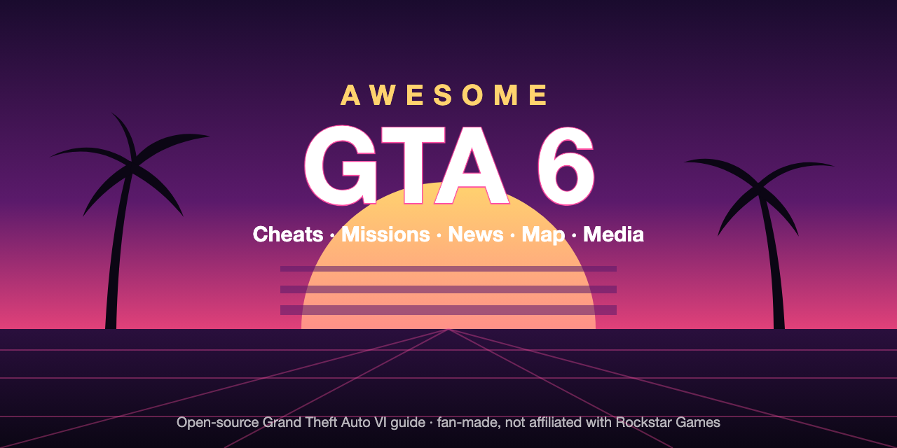

<div align="center">

<a href="https://www.teekamsuthar.com/awesome-gta-6/"></a>

# Awesome GTA 6

**The open-source Grand Theft Auto VI guide: GTA 6 cheat codes, the full mission list, daily news, official trailers & wallpapers, the Leonida map, and PC & GTA 6 Online trackers, with free JSON data.**

[-brightgreen)](https://www.rockstargames.com/VI)
[](https://www.teekamsuthar.com/awesome-gta-6/cheat-codes)
[](https://www.teekamsuthar.com/awesome-gta-6/missions)
[](https://github.com/teekamsuthar/awesome-gta-6/commits/main)
[](LICENSE)
[](contributing.md)

**[🌐 Website](https://www.teekamsuthar.com/awesome-gta-6/)** · **[🎮 Cheats](https://www.teekamsuthar.com/awesome-gta-6/cheat-codes)** · **[📜 Missions](https://www.teekamsuthar.com/awesome-gta-6/missions)** · **[📰 News](https://www.teekamsuthar.com/awesome-gta-6/news)** · **[❓ FAQ](https://www.teekamsuthar.com/awesome-gta-6/faq)**

⭐ **Star this repo** to get notified when the PC release, GTA 6 Online or new cheat codes drop.

</div>

> This is a fan-made, community-maintained project. It is **not affiliated with or endorsed by Rockstar Games or Take-Two Interactive.** Grand Theft Auto, GTA and all related trademarks, trailers and artwork belong to their owners. We link to official media and never re-host it.

## Contents

- [GTA 6 at a Glance](#gta-6-at-a-glance)
- [Latest GTA 6 News](#latest-gta-6-news)
- [GTA 6 Cheat Codes](#gta-6-cheat-codes)
- [GTA 6 Mission List](#gta-6-mission-list)
- [Official Trailers, Screenshots & Wallpapers](#official-trailers-screenshots--wallpapers)
- [GTA 6 Map](#gta-6-map)
- [PC Release & GTA 6 Online Trackers](#pc-release--gta-6-online-trackers)
- [Guides & Walkthroughs](#guides--walkthroughs)
- [Leaks, Rumors & Datamines](#leaks-rumors--datamines)
- [Community](#community)
- [JSON Data for Developers](#json-data-for-developers)
- [FAQ](#faq)
- [Contributing](#contributing)

## GTA 6 at a Glance

| | |
| :--- | :--- |
| **Release date** | November 19, 2026 |
| **Platforms** | PS5, PS5 Pro, Xbox Series X\|S, Xbox Cloud Gaming |
| **PC** | ❌ Not announced. See the [PC tracker](docs/pc-release.md) |
| **Setting** | Leonida (fictional Florida) and Vice City |
| **Main characters** | Jason Duval & Lucia Caminos |
| **Story** | 91 missions in 5 chapters ([one guide counts 93](docs/missions.md)) |
| **Price (US)** | $79.99 Standard · $99.99 Ultimate ([editions](docs/editions.md)) |
| **Download size** | Up to 212 GB |
| **Metacritic** | 99 |
| **GTA 6 Online** | No date yet ([tracker](docs/gta-6-online.md)) |

## Latest GTA 6 News

- **Nov 20, 2026:** Players report a first-person glitch; Rockstar hasn't commented. *(unconfirmed)*
- **Nov 19, 2026:** GTA 6 launches on PS5 and Xbox Series X|S with a **99 on Metacritic**.
- **Nov 19, 2026:** Sensor Tower estimates **~24.6M copies / ~$2.36B** including preorders. *(third-party estimate)*
- **Nov 19, 2026:** Early PSN sign-in trouble, since cleared. Players report a 602 MB update fixes PS5 error CE-108255-1.
- **Warning:** "GTA 6 PC download" sites are scams, and some carry malware.

**[→ All GTA 6 news, dated and sourced](docs/news.md)**

## GTA 6 Cheat Codes

GTA 6 has **61 cheats**. They unlock **after you finish the story** plus a challenge for each cheat.
**To enter one:** press D-pad ⬆️ to open the phone → hold **L1 + R1** (PS5) or **LB + RB** (Xbox) → enter the code. Cheats disable trophies and saving while they're on.

| Cheat | Input | Unlock |
| :--- | :--- | :--- |
| **$250,000 money** | ⬆️ ➡️ ⬇️ ⬅️ ⬆️ ⬅️ ⬇️ ➡️ | Finish the story |
| **Max Ammo** | ⬇️ ⬆️ ➡️ ⬇️ ⬅️ ⬅️ ⬆️ ⬆️ ⬇️ ⬅️ | 25 bronze shooting-range medals |
| **Infinite Ammo** | ⬇️ ⬆️ ➡️ ⬇️ ⬅️ ⬅️ ⬆️ ⬇️ ⬇️ ⬇️ | 25 silver medals |
| **No Reload** | ⬇️ ⬆️ ➡️ ⬇️ ⬅️ ⬅️ ⬆️ ⬇️ ⬇️ ⬆️ | 25 gold medals |
| **Body Armor** | ⬇️ ⬆️ ⬅️ ⬆️ ⬆️ ⬆️ ⬆️ ⬆️ ⬇️ ⬇️ | 100 workouts |
| **Raise Heat Level** | ⬅️ ⬇️ ➡️ ⬇️ ⬆️ ⬇️ ⬆️ | Lose a 3-star wanted level 25 times |
| **Unlimited Focus** | ⬇️ ⬆️ ⬆️ ⬇️ ⬆️ ⬇️ ⬆️ ⬇️ ⬆️ ➡️ | Finish the story |
| **Cycle Weather** | ⬇️ ➡️ ⬆️ ⬇️ ➡️ ⬆️ ➡️ | Finish the story |

**[→ All 61 GTA 6 cheats with unlock requirements](docs/cheat-codes.md)** · [cheats.json](data/cheats.json)

## GTA 6 Mission List

| Chapter | Title | Missions |
| :--- | :--- | ---: |
| 1 | Just Like Paradise | 22 |
| 2 | Paradise Lost | 11 |
| 3 | Tits, Ass, Drug Money | 26 |
| 4 | Vice City, Baby | 25 |
| 5 | Top of the World, Ma | 7 |

**[→ Every GTA 6 mission in order (spoilers hidden)](docs/missions.md)** · [missions.json](data/missions.json)

## Official Trailers, Screenshots & Wallpapers

- [Official GTA VI Page](https://www.rockstargames.com/VI): overview, characters and Leonida.
- [Official Media Hub](https://www.rockstargames.com/VI/media): every official trailer, screenshot and artwork in one place.
- [Trailers & Videos](https://www.rockstargames.com/VI/media/videos): official trailer downloads.
- [Screenshots](https://www.rockstargames.com/VI/media/screenshots): high-resolution official screenshots.
- [4K Wallpapers & Artwork](https://www.rockstargames.com/VI/media/artwork-wallpapers): desktop and phone wallpapers, key art.
- [Launch Gallery](https://www.rockstargames.com/VI/launch-gallery): launch-day screenshot showcase.
- [Rockstar Games on YouTube](https://www.youtube.com/@RockstarGames): watch the trailers in 4K.

**[→ Media guide](docs/media.md)**

## GTA 6 Map

- [MapGenie GTA 6 Interactive Map](https://mapgenie.io/grand-theft-auto-6): collectibles, activities and points of interest.
- [How Big Is the GTA 6 Map?](docs/map.md): official comparisons vs community measurements.

## PC Release & GTA 6 Online Trackers

- [GTA 6 PC Release Date Tracker](docs/pc-release.md): what's confirmed, what's rumored, and how long past GTA PC ports took.
- [GTA 6 Online Tracker](docs/gta-6-online.md): release date status and reports.
- [Price, Editions & Download Size](docs/editions.md): Standard vs Ultimate, 212 GB, platforms.

## Guides & Walkthroughs

- [IGN GTA 6 Guide](https://www.ign.com/wikis/gta-6): mission walkthroughs, weapons and vehicles.
- [GamesRadar+ Mission List](https://www.gamesradar.com/games/grand-theft-auto/gta-6-mission-list/): every main objective and chapter.
- [PowerPyx](https://www.powerpyx.com): trophy and achievement guides, 100% checklists.
- [GTABase](https://www.gtabase.com/grand-theft-auto-vi/): vehicle, weapon and property database.
- [GTA Series Videos](https://www.youtube.com/@GTASeriesVideos): no-commentary video walkthroughs.
- [Digital Foundry](https://www.youtube.com/@DigitalFoundry): PS5, PS5 Pro and Xbox Series X|S performance analysis.

## Leaks, Rumors & Datamines

> ⚠️ Everything here is **unconfirmed** until Rockstar says otherwise. We link to reporting only, never to leaked files.

- [Leaks & Rumors Tracker](docs/rumors-and-leaks.md): PC port, GTA 6 Online and story DLC rumors, each marked confirmed, debunked or unverified.
- [r/GamingLeaksAndRumours](https://www.reddit.com/r/GamingLeaksAndRumours/): rumor aggregator with sourcing rules.
- [Insider Gaming](https://insider-gaming.com): industry reporting on post-launch plans.
- [Tez2 (@TezFunz2)](https://x.com/TezFunz2): long-time GTA dataminer.
- [GTAForums](https://gtaforums.com): datamining and long-form discussion.

## Community

- [r/GTA6](https://www.reddit.com/r/GTA6/): the main GTA 6 subreddit.
- [r/GTA](https://www.reddit.com/r/GTA/): all things Grand Theft Auto.
- [GTA Wiki](https://gta.fandom.com/wiki/Grand_Theft_Auto_VI): crowdsourced lore encyclopedia.
- [Rockstar Newswire](https://www.rockstargames.com/newswire): official news and patch notes.
- [Rockstar Support](https://support.rockstargames.com): server status and known issues.

## JSON Data for Developers

Building a Discord bot, app or fan site? All data is **CC0 (public domain)**, so you can use it with no permission needed.

| File | Contents |
| :--- | :--- |
| [`data/cheats.json`](data/cheats.json) | 61 cheats: input, unlock requirement, verification status, sources |
| [`data/missions.json`](data/missions.json) | 91 missions by chapter, spoiler flags |
| [`data/news.json`](data/news.json) | Dated, sourced news with confirmed/unconfirmed flag |
| [`data/sources.json`](data/sources.json) | Every link in this list, by tier |

```bash
curl https://raw.githubusercontent.com/teekamsuthar/awesome-gta-6/main/data/cheats.json
```

## FAQ

<details><summary><b>Is GTA 6 out?</b></summary>Yes. It launched November 19, 2026 on PS5 and Xbox Series X|S.</details>
<details><summary><b>Is GTA 6 on PC?</b></summary>No. Rockstar hasn't announced a PC version. Any "PC download" is fake. <a href="docs/pc-release.md">PC tracker</a>.</details>
<details><summary><b>How many missions are in GTA 6?</b></summary>91 main story missions across 5 chapters, per most guides. One guide counts 93.</details>
<details><summary><b>How do I use cheats in GTA 6?</b></summary>Finish the story and the cheat's challenge, open the phone with D-pad Up, hold L1+R1 (PS5) or LB+RB (Xbox), then enter the code.</details>
<details><summary><b>What's the GTA 6 money cheat?</b></summary>$250,000: Up, Right, Down, Left, Up, Left, Down, Right. It unlocks after the story.</details>
<details><summary><b>When does GTA 6 Online come out?</b></summary>No official date. Reports say 2027 (unconfirmed).</details>

**[→ Full FAQ](https://www.teekamsuthar.com/awesome-gta-6/faq)**

## Contributing

Found a new cheat code, a bug in the mission list, fresh news or a rumor? Contributions are welcome. Read the [contributing guide](contributing.md) or open an issue:
[Submit a cheat](https://github.com/teekamsuthar/awesome-gta-6/issues/new?template=cheat.yml) · [Submit news](https://github.com/teekamsuthar/awesome-gta-6/issues/new?template=news.yml) · [Submit a rumor](https://github.com/teekamsuthar/awesome-gta-6/issues/new?template=rumor.yml) · [Report wrong info](https://github.com/teekamsuthar/awesome-gta-6/issues/new?template=correction.yml)

## License

[](LICENSE)

To the extent possible under law, the contributors have waived all copyright and related rights to this list and its data. Game names, trademarks and media remain the property of their owners.
